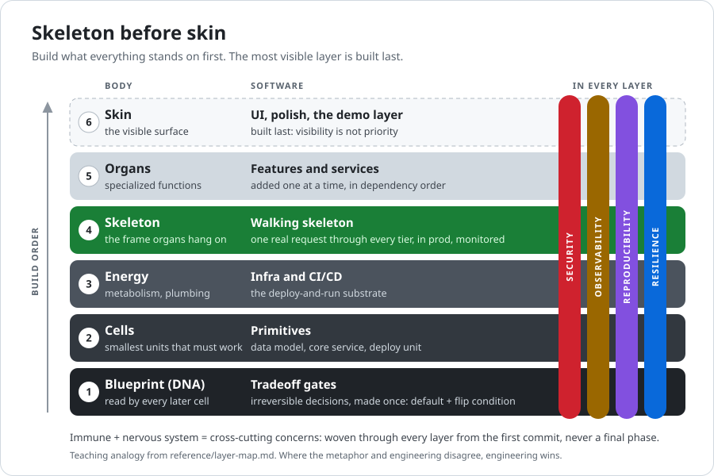

<div align="center">

# Dependency-First Architect

**Your coding agent plans what everything else depends on first.**

A planning skill for Claude Code, Cursor, and Codex

[](https://github.com/NiravRVaghasiya/dependency-first-architect/actions/workflows/ci.yml)
[](LICENSE)

[Install](#install) · [What you get](#what-you-get) · [Evidence](#evidence) · [Limits](#limits) · [Contributing](#contributing)

</div>

---

Ask your agent to "plan a customer-support chatbot over our help-center docs". With this skill,
you get a **build plan in dependency order** instead of a list of components: the foundations
first, a test for every risky assumption, and no real users until those tests pass.

It is only Markdown instructions, no code.

## Install

**1. Check that you have Python 3.9 or newer.** Run `python3 --version` (on Windows,
`py --version`). No Python? [Install by hand](#install-by-hand) instead.

**2. Open a terminal in your project's folder and paste the block for your system.**

**macOS, Linux, WSL, Git Bash** (in Git Bash, if `python3` is not found, change it to `py -3` in the
last line):

```bash
f=install-dependency-first-architect-v2.2.0.py; t="$(mktemp -d)"
curl -fsSL -o "$t/$f" "https://github.com/NiravRVaghasiya/dependency-first-architect/releases/download/v2.2.0/$f" || echo "Download failed."
h="$(sha256sum "$t/$f" 2>/dev/null || shasum -a 256 "$t/$f" 2>/dev/null)"
if [ "${h%% *}" = "049cebdad78b00cb661413318fb074991a8cd4898a806d8fc1dba201ce795bbd" ]; then python3 -I "$t/$f"; else echo "Not run: the installer is missing or does not match its published checksum."; fi
```

**Windows PowerShell:**

```powershell
$f = "install-dependency-first-architect-v2.2.0.py"; $d = Join-Path ([IO.Path]::GetTempPath()) ([guid]::NewGuid()); $null = New-Item -ItemType Directory $d; $t = Join-Path $d $f
curl.exe -fsSL -o $t "https://github.com/NiravRVaghasiya/dependency-first-architect/releases/download/v2.2.0/$f"
if ((Test-Path $t) -and (Get-FileHash $t).Hash -eq "049cebdad78b00cb661413318fb074991a8cd4898a806d8fc1dba201ce795bbd") { py -3 -I $t } else { "Not run: the installer is missing or does not match its published checksum." }
```

The installer finds which agent your project uses (or asks you once) and prints `Done.` when every
file is in place and checked.

**3. Try it.** Start a new session of your agent and ask: *"Plan a customer-support chatbot over
our help-center docs."* In Claude Code you can also type `/dependency-first-architect` followed by
your request.

The installer writes only these files. Commit them to share the skill with your team.

| Agent | Files in your project |
|---|---|
| Claude Code | `.claude/skills/dependency-first-architect/` (`SKILL.md`, 4 reference files, `LICENSE`) |
| Cursor | `.cursor/rules/dependency-first-architect.mdc` |
| Codex | `.codex/dependency-first-architect.md`, plus a short block in `AGENTS.md` that points to it (the rest of `AGENTS.md` is kept) |

> [!NOTE]
> The block runs the installer only if its SHA-256 matches the one above, and the installer makes
> no network connection. Details: [SECURITY.md](SECURITY.md) and
> [docs/distribution.md](docs/distribution.md#the-installer).

### Options

Add an option at the end of the block's last command, after `python3 -I "$t/$f"` (PowerShell:
`py -3 -I $t`):

| Option | What it does |
|---|---|
| `--agent claude-code`, `--agent cursor`, `--agent codex` | install for that agent instead of detecting it |
| `--global` | Claude Code only: install in `~/.claude/skills`, for all your projects |
| `--dry-run` | show what would change, and change nothing |
| `--verify` | check that what is installed is exactly this release |
| `--uninstall` | remove what the installer wrote, and nothing else |
| `--project DIR` | install in another folder |

For example, to pick the agent yourself in bash, after the block has run without a `Not run` line:

```bash
python3 -I "$t/$f" --agent claude-code
python3 -I "$t/$f" --agent cursor
python3 -I "$t/$f" --agent codex
```

In PowerShell: `py -3 -I $t --agent claude-code` (or `cursor`, `codex`).

### Update or remove

- **Update:** paste the block from a newer release's README.
- **Remove:** run the installer with `--uninstall`. Add `--global` for the copy in
  `~/.claude/skills`.
- **Your own files are safe.** If you edited the Claude Code skill or added files to its folder,
  the installer stops and tells you before it writes anything.

### Install by hand

<details>
<summary>Without Python: download the files yourself</summary>

1. From the
   [v2.2.0 release](https://github.com/NiravRVaghasiya/dependency-first-architect/releases/tag/v2.2.0),
   download the file for your agent and `SHA256SUMS` into a new, empty folder.
2. Check them: in that folder, run `sha256sum -c --ignore-missing SHA256SUMS` (macOS:
   `shasum -a 256 -c --ignore-missing SHA256SUMS`; PowerShell: compare
   `(Get-FileHash <file>).Hash` with the file's line in `SHA256SUMS`).
3. Put them in your project:

| Agent | Download | Put it here |
|---|---|---|
| Claude Code | `dependency-first-architect-v2.2.0.zip` | unzip it and move its `dependency-first-architect` folder into `.claude/skills/` (delete an older copy first) |
| Cursor | `cursor-dependency-first-architect.mdc` | `.cursor/rules/dependency-first-architect.mdc` |
| Codex | `codex-lazy-dependency-first-architect.md` and `codex-lazy-AGENTS-snippet.md` | the first to `.codex/dependency-first-architect.md`; paste the second at the end of `AGENTS.md`, once |
| Codex, one file | `codex-AGENTS.md` | paste it at the end of `AGENTS.md`, once (smaller, without the reference files) |

The installer itself, `install-dependency-first-architect-v2.2.0.py`, is in the release too.

To build the release yourself from a commit you reviewed (it gives the same bytes as the release;
[details](docs/distribution.md#rebuilding)):

```bash
git clone https://github.com/NiravRVaghasiya/dependency-first-architect dfa-source
cd dfa-source && git checkout v2.2.0
python3 package_skill.py
```

The installer is then in `dist/release/`.

</details>

### Troubleshooting

<details>
<summary>Common messages and what to do</summary>

| You see | What to do |
|---|---|
| `python3: command not found`, or "Python was not found" | Install Python 3.9+ from python.org (on Windows, keep "py launcher" ticked), or [install by hand](#install-by-hand). |
| `Download failed.`, or a 404 | Check that you are online. Behind a proxy, add `curl`'s `--proxy` option. |
| `Not run: ... checksum` | Don't run the file. Paste the block again; if it still fails, report it ([SECURITY.md](SECURITY.md)). |
| `Could not tell which coding agent this project uses`, or `No agent chosen` | Add `--agent claude-code`, `--agent cursor` or `--agent codex`. |
| `Stopped: ...` | A file of yours is where the installer writes, or a file is read-only. Move it, undo the edit, or make it writable, and run again. |
| `FAILED to write ...` | Another program has the file open (on Windows, often the agent). Close it and run again. |
| The agent ignores the skill | Start a new session and run the installer with `--verify`. |

</details>

## What you get

Every plan has the same ten sections ([template](reference/plan-template.md)):

| Sections 1–5 | Sections 6–10 |
|---|---|
| 1. Classification and constraints | 6. Validation gates |
| 2. Dependency map | 7. Cross-cutting concerns |
| 3. Tradeoff gates | 8. AI layer (AI systems only) |
| 4. Walking skeleton (Phase 0) | 9. Methodology exceptions |
| 5. Phases | 10. Deliberately deferred |

What the skill changes:

- **A walking skeleton first.** Phase 0 sends one real request through every part of the system,
  in production, monitored, with a rollback tried once.
- **Hard-to-undo choices decided up front**, each with a default and what would change it.
- **A test for every risky assumption** (V0, V1, …), with a pass bar. Real users wait until the
  tests that protect them pass.
- **Honest numbers.** Every target is labeled as a requirement, a baseline, an assumption, or
  unknown.
- **Security and monitoring in every phase**, not saved for the end. For AI systems, defenses and
  cost limits come before new features.

See a [full example plan](eval/results/2026-10-03-pilot-core/generations/P1.dfa.opus-5.5.r01.md).

<p align="center">
  
</p>

<p align="center"><sub>The order, as a picture. The full method is in <a href="SKILL.md">SKILL.md</a>.</sub></p>

## Evidence

Measured in Claude Code, with plans by Opus 5.5 on skill v2.0.0. Later versions keep the same
method with tighter guidance, and no run has measured them yet.

<!-- Hand-copied from the generated block below. No check compares these figures with the
records, so update them whenever the block changes. -->

- **Plans follow the method:** adherence +11.6 of 20 [+10.6, +12.6] over the same model without a
  skill.
- **LLM judges rate them higher than without a skill** (engineering quality +8.2 of 44
  [+5.3, +11.0]), **but slightly lower than an independently written planning skill**
  (−1.2 [−1.9, −0.5]).
- **Plans are longer:** about 2.7 times the length of a plan without a skill.
- **No measured effect yet on the code built from a plan** (+0.01 [−0.05, +0.07] in hidden-test
  pass rate).

<details>
<summary><b>Full results from every committed run</b></summary>

Adherence (/20) is the skill author's own rubric, so skill plans score high by construction. EQ
(engineering quality, /44) is an LLM judge's score of the written plan, from a rubric written
without seeing the skill. Intervals are 95%. Every judge is a Claude model. Protocol and
limitations: [eval/README.md](eval/README.md).

<!-- BEGIN GENERATED evidence: eval/dfa_eval/evidence.py -->

_Generated from the committed runs by `eval/dfa_eval/evidence.py`; `python eval/run.py check` fails if this block and the records disagree. Cells: mean difference, treatment − control, with its 95% interval (t across prompts for plans; bootstrap over attempts for outcomes)._

**[`2026-10-03-outcomes-webhook-ledger`](eval/results/2026-10-03-outcomes-webhook-ledger/OUTCOMES.md)** — task `eval/outcomes/tasks/webhook-ledger`; planner claude-opus-5-5; implementer claude-sonnet-5-5; 20 complete attempts of 20 planned.

| Treatment − control | n | Round-1 pass rate | Change-request pass rate | Regression pass rate | Rework lines |
|---|---|---|---|---|---|
| dfa-plan − baseline-plan | 5 vs 5 | +0.01 [−0.05, +0.07] | +0.00 [+0.00, +0.00] | +0.01 [−0.05, +0.07] | −12 [−38, +10] |
| baseline-plan − no-plan | 5 vs 5 | +0.09 [−0.09, +0.36] | +0.20 [+0.00, +0.60] | +0.09 [−0.09, +0.36] | +3 [−19, +24] |
| dfa-plan − no-plan | 5 vs 5 | +0.10 [−0.07, +0.38] | +0.20 [+0.00, +0.60] | +0.10 [−0.07, +0.38] | −9 [−34, +11] |
| generic-plan − baseline-plan | 5 vs 5 | +0.03 [−0.02, +0.09] | +0.00 [+0.00, +0.00] | +0.03 [−0.02, +0.07] | −9 [−30, +13] |
| dfa-plan − generic-plan | 5 vs 5 | −0.02 [−0.07, +0.03] | +0.00 [+0.00, +0.00] | −0.02 [−0.07, +0.03] | −4 [−29, +17] |

- caveats, dfa-plan − baseline-plan: n < 10 attempts per arm: descriptive only
- caveats, baseline-plan − no-plan: n < 10 attempts per arm: descriptive only
- caveats, dfa-plan − no-plan: n < 10 attempts per arm: descriptive only
- caveats, generic-plan − baseline-plan: n < 10 attempts per arm: descriptive only
- caveats, dfa-plan − generic-plan: n < 10 attempts per arm: descriptive only
- flag: planner sessions ran with output style 'Concise' and permission mode auto (15) (the operator's Claude Code settings apply under --bare)
- flag: implementer sessions ran with output style 'Concise' and permission mode acceptEdits (40) (the operator's Claude Code settings apply under --bare)
- recorded cost $16.66

**[`2026-10-03-pilot-core`](eval/results/2026-10-03-pilot-core/REPORT.md)** — config `pilot-core`; generator claude-opus-5-5 (effort high); judges claude-sonnet-5-5, claude-fable-5; 5 run(s) per cell configured.

| Treatment − control | Generator | n prompts | Plans | Adherence /20 | EQ /44 | EQ-core /36 | Checklist 0–1 | Words | EQ per 1k tokens |
|---|---|---:|---|---|---|---|---|---|---|
| dfa − baseline | opus-5.5 | 8 | 40 vs 40 | +11.6 [+10.6, +12.6] | +8.2 [+5.3, +11.0] | +6.0 [+3.7, +8.4] | +0.04 [−0.06, +0.13] | +2482 [+2001, +2964] | −7.91 [−11.17, −4.65] |
| dfa − generic-control | opus-5.5 | 8 | 40 vs 40 | +2.3 [+1.0, +3.6] | −1.2 [−1.9, −0.5] | −1.2 [−1.8, −0.7] | −0.05 [−0.07, −0.03] | −4372 [−5316, −3427] | +3.63 [+3.04, +4.22] |
| dfa − dfa-v1 | opus-5.5 | 8 | 40 vs 40 | −0.1 [−0.1, +0.0] | +1.9 [+1.2, +2.5] | +1.6 [+1.0, +2.1] | −0.02 [−0.04, −0.00] | +704 [+354, +1053] | −0.61 [−1.32, +0.10] |
| dfa-v1 − baseline | opus-5.5 | 8 | 40 vs 40 | +11.7 [+10.6, +12.7] | +6.3 [+3.8, +8.8] | +4.5 [+2.5, +6.4] | +0.06 [−0.02, +0.15] | +1778 [+1392, +2165] | −7.31 [−10.60, −4.02] |
| generic-control − baseline | opus-5.5 | 8 | 40 vs 40 | +9.3 [+7.6, +11.0] | +9.3 [+6.5, +12.2] | +7.3 [+4.9, +9.6] | +0.09 [−0.01, +0.18] | +6854 [+5685, +8023] | −11.54 [−14.73, −8.36] |

- caveats, dfa − baseline (opus-5.5): ceiling: 92% of treatment generations at max (Adherence)
- caveats, dfa − generic-control (opus-5.5): ceiling: 92% of treatment generations at max (Adherence)
- caveats, dfa − dfa-v1 (opus-5.5): ceiling: 92% of treatment generations at max (Adherence)
- caveats, dfa-v1 − baseline (opus-5.5): ceiling: 98% of treatment generations at max (Adherence)
- caveats, generic-control − baseline (opus-5.5): ceiling: 18% of treatment generations at max (Adherence); ceiling: 2% of treatment generations at max (Checklist)
- flag: generation sessions ran with output style 'Concise' (160 plans) (the operator's Claude Code settings apply under --bare)
- EQ by judge, dfa − baseline (opus-5.5): fable-5 +6.2 [+3.1, +9.3]; sonnet-5.5 +10.1 [+7.4, +12.8]
- EQ by judge, dfa − generic-control (opus-5.5): fable-5 −0.9 [−1.4, −0.4]; sonnet-5.5 −1.5 [−2.7, −0.2]
- EQ by judge, dfa − dfa-v1 (opus-5.5): fable-5 +1.0 [+0.4, +1.6]; sonnet-5.5 +2.7 [+1.7, +3.7]
- EQ by judge, dfa-v1 − baseline (opus-5.5): fable-5 +5.2 [+2.5, +7.9]; sonnet-5.5 +7.4 [+4.9, +10.0]
- EQ by judge, generic-control − baseline (opus-5.5): fable-5 +7.1 [+4.1, +10.1]; sonnet-5.5 +11.6 [+8.6, +14.6]
- leakage-probe AUC (judge sonnet-5.5, opus-5.5 plans): dfa vs baseline 1.00, dfa vs generic-control 0.99, dfa vs dfa-v1 0.83, dfa-v1 vs baseline 1.00, generic-control vs baseline 1.00
- judge agreement on engineering-quality-v1 (Krippendorff α, 2 coders): 0.12; rank agreement (Spearman) 0.83, with fable-5#1 scoring +6.9 points relative to sonnet-5.5#1
- recorded cost $199.16

**[`2026-10-03-pilot-length`](eval/results/2026-10-03-pilot-length/REPORT.md)** — config `pilot-length`; generator claude-opus-5-5 (effort high); judges claude-sonnet-5-5; 3 run(s) per cell configured.

| Treatment − control | Generator | n prompts | Plans | Adherence /20 | EQ /44 | EQ-core /36 | Checklist 0–1 | Words | EQ per 1k tokens |
|---|---|---:|---|---|---|---|---|---|---|
| dfa-capped − baseline-capped | opus-5.5 | 5 | 15 vs 15 | +11.2 [+9.6, +12.8] | +9.6 [+7.0, +12.2] | +6.3 [+4.1, +8.5] | −0.03 [−0.13, +0.06] | +429 [+117, +741] | +2.08 [−0.18, +4.33] |

- caveats, dfa-capped − baseline-capped (opus-5.5): ceiling: 67% of treatment generations at max (Adherence)
- flag: generation sessions ran with output style 'Concise' (30 plans) (the operator's Claude Code settings apply under --bare)
- leakage-probe AUC (judge sonnet-5.5, opus-5.5 plans): dfa-capped vs baseline-capped 1.00
- recorded cost $7.45

**[`2026-10-03-pilot-models`](eval/results/2026-10-03-pilot-models/REPORT.md)** — config `pilot-models`; generator claude-sonnet-5-5 (effort high), claude-haiku-4-5-20251001 (effort default); judges claude-sonnet-5-5; 3 run(s) per cell configured.

| Treatment − control | Generator | n prompts | Plans | Adherence /20 | EQ /44 | EQ-core /36 | Checklist 0–1 | Words | EQ per 1k tokens |
|---|---|---:|---|---|---|---|---|---|---|
| dfa − baseline | sonnet-5.5 | 5 | 15 vs 15 | +11.7 [+10.2, +13.3] | +10.9 [+6.3, +15.4] | +7.8 [+3.7, +11.9] | +0.05 [−0.11, +0.21] | +1936 [+1300, +2572] | −7.60 [−13.63, −1.57] |
| dfa − baseline | haiku-4.5 | 5 | 15 vs 15 | +13.8 [+10.1, +17.5] | +14.1 [+6.9, +21.4] | +10.1 [+3.5, +16.7] | +0.17 [−0.02, +0.36] | +5046 [+3298, +6794] | −5.06 [−13.86, +3.74] |

- caveats, dfa − baseline (sonnet-5.5): ceiling: 93% of treatment generations at max (Adherence); judge model also generated these plans (Adherence, EQ, EQ-core, Checklist, EQ per 1k tokens)
- caveats, dfa − baseline (haiku-4.5): ceiling: 13% of treatment generations at max (Adherence)
- flag: condition dfa, generator haiku-4.5: 14 of 15 plans could not read the skill's files (all 35 reads of them failed), so they follow SKILL.md alone, not the skill as shipped
- flag: generation sessions ran with output style 'Concise' (60 plans) (the operator's Claude Code settings apply under --bare)
- flag: generation sessions ran in different permission modes: auto (sonnet-5.5 30); default (haiku-4.5 30)
- flag: judge sonnet-5.5 uses the generator's model claude-sonnet-5-5 (generator sonnet-5.5): it judged plans its own model wrote
- leakage-probe AUC (judge sonnet-5.5, sonnet-5.5 plans): dfa vs baseline 1.00
- leakage-probe AUC (judge sonnet-5.5, haiku-4.5 plans): dfa vs baseline 1.00
- recorded cost $11.45

**[`2026-10-03-pilot-models-haiku`](eval/results/2026-10-03-pilot-models-haiku/REPORT.md)** — config `pilot-models-haiku`; generator claude-haiku-4-5-20251001 (effort default); judges claude-sonnet-5-5; 3 run(s) per cell configured.

| Treatment − control | Generator | n prompts | Plans | Adherence /20 | EQ /44 | EQ-core /36 | Checklist 0–1 | Words | EQ per 1k tokens |
|---|---|---:|---|---|---|---|---|---|---|
| dfa − baseline | haiku-4.5 | 5 | 15 vs 15 | +14.5 [+11.9, +17.0] | +14.9 [+7.6, +22.3] | +10.7 [+4.0, +17.3] | +0.25 [+0.04, +0.46] | +3970 [+1839, +6102] | −3.19 [−10.40, +4.02] |

- caveats, dfa − baseline (haiku-4.5): ceiling: 7% of treatment generations at max (Adherence)
- flag: generation sessions ran with output style 'Concise' (30 plans) (the operator's Claude Code settings apply under --bare)
- leakage-probe AUC (judge sonnet-5.5, haiku-4.5 plans): dfa vs baseline 1.00
- recorded cost $5.27

**[`2026-10-03-v1-examples-rejudge`](eval/results/2026-10-03-v1-examples-rejudge/REPORT.md)** — config `v1-examples-rejudge`; generator claude-opus-5-5 (effort max); judges claude-sonnet-5-5, claude-fable-5; 1 run(s) per cell configured.

| Treatment − control | Generator | n prompts | Plans | Adherence /20 | EQ /44 | EQ-core /36 | Checklist 0–1 | Words | EQ per 1k tokens |
|---|---|---:|---|---|---|---|---|---|---|
| dfa-v1 − baseline | opus-5.5-max | 5 | 5 vs 5 | +8.4 [+4.4, +12.4] | +3.4 [+0.9, +5.9] | +2.5 [+0.2, +4.8] | +0.07 [−0.05, +0.19] | +2675 [+1186, +4164] | −8.05 [−18.46, +2.35] |

- caveats, dfa-v1 − baseline (opus-5.5-max): ceiling: 100% of treatment generations at max (Adherence); no variation within prompts: g undefined (Adherence, EQ, EQ-core, Checklist, Words, EQ per 1k tokens); ceiling: 20% of treatment generations at max (Checklist)
- flag: manifest note: Imported, not generated: the plans in examples/ as committed, verified against the SHA-256 recorded in examples/scoring/generation.json at generation time (2026-10-02, model claude-opus-5-5, effort max, skill commit 3ba6b70). Tokens, cost and latency were not recorded in v1.
- flag: small n: 1 run(s) per cell (< 3)
- EQ by judge, dfa-v1 − baseline (opus-5.5-max): fable-5 +2.2 [−0.0, +4.4]; sonnet-5.5 +4.6 [+0.6, +8.6]
- leakage-probe AUC (judge sonnet-5.5, opus-5.5-max plans): dfa-v1 vs baseline 1.00
- judge agreement on engineering-quality-v1 (Krippendorff α, 2 coders): −0.34; rank agreement (Spearman) 0.71, with fable-5#1 scoring +7.2 points relative to sonnet-5.5#1
- recorded cost $7.38
<!-- END GENERATED evidence -->

The v1.0.0 pilot is kept as published ([plans and scorecard](examples/README.md)):

<!-- BEGIN GENERATED score callout: examples/scoring/tally.py -->
> **v1.0.0, methodology adherence.** In Claude Code (same model, the 5 fixed prompts in [`reference/evals.md`](reference/evals.md), one run per arm, 3 judges on the same model, blind to the arm), plans scored **12.8/20 without the skill and 20.0/20 with it (+7.2)** on the skill's own rubric. On a deliberately skill-unfavorable reading (every dispute from an adversarial audit accepted, and the D9 rubric artifact removed), the difference is still **+5.6**. That rubric checks what the skill asks for, and v1's plans self-scored against it before answering, so this shows the method is followed, not that the plans are better engineering. [Scorecard, method and raw scores →](examples/SCORECARD.md)
<!-- END GENERATED -->

</details>

## Limits

- **It shapes how a model plans, not what it knows.** The model can still be wrong about
  technologies, limits, and costs.
- **Gates name checks; they don't run them.** Someone still has to.
- **Results vary by model**, and Cursor and Codex are supported but not yet evaluated.
- **Not yet validated:** effects on
  [production outcomes](eval/outcomes/README.md#what-it-does-not-measure) and judges outside the
  Claude family. See [Limitations](eval/README.md#limitations).

## Contributing

**`SKILL.md` is the single source of truth.** Change the method there or in `reference/`, run
`python build.py`, and commit what it regenerates. Never edit `adapters/` by hand.

```bash
python build.py --check                # adapters and SHA256SUMS match SKILL.md
python package_skill.py                # build and check the release
python -m unittest discover -s tests   # offline tests, no model calls
python eval/run.py check               # committed eval runs and this README's evidence block
```

Running the benchmark against real models costs money
([eval/README.md](eval/README.md#credentials-network-and-cost)). More in
[CONTRIBUTING.md](CONTRIBUTING.md); changes in [CHANGELOG.md](CHANGELOG.md).

## License

[MIT](LICENSE)
